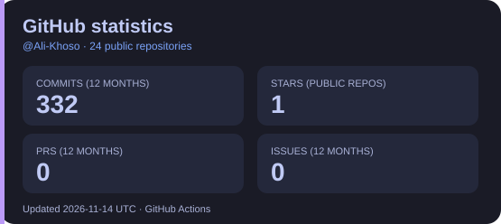
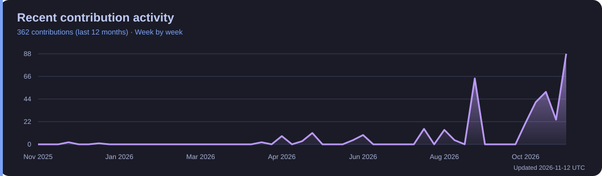

# Hi 👋, I’m Ali Ahmed Khoso

### AI Automation Engineer | AI Voice Agents | CRM & Lead Automation

---

## 🤖 About Me

- ⚙️ Building AI-powered business automations with **n8n, GoHighLevel (GHL), Make, Zapier, and Airtable**.
- 🎙️ Creating **AI voice agents, automated receptionists, and appointment-booking flows** with **Vapi and Twilio**.
- 📈 Working on **CRM workflows, B2B lead generation, cold outreach, and follow-up automation**.
- 🔗 Connecting apps through **APIs, webhooks, AI agents, and LangChain/RAG**.
- 💻 Also building web, mobile, and desktop applications using **Python, React, Kotlin, and C#/.NET**.
- 📬 **Email:** [aliahmedkhoso17081@gmail.com](mailto:aliahmedkhoso17081@gmail.com)

## 🛠️ Automation Tools & Technologies

## ⚡ Automation & AI Projects

- [**Cold-Email-Automation**](https://github.com/Ali-Khoso/Cold-Email-Automation) — AI-assisted cold-email outreach workflow.
- [**n8n-Leads-scraper**](https://github.com/Ali-Khoso/n8n-Leads-scraper) — Lead-scraping workflow with n8n.
- [**ai-leadgen-system**](https://github.com/Ali-Khoso/ai-leadgen-system) — AI-powered lead generation.
- [**google-maps-scraper**](https://github.com/Ali-Khoso/google-maps-scraper) — Python automation for lead collection.

## 💻 Other Projects

**Mobile & Desktop**

- [SpreadHopeFoundation](https://github.com/Ali-Khoso/SpreadHopeFoundation) — Android application.
- [Student-Info-Mangement-Portal](https://github.com/Ali-Khoso/Student-Info-Mangement-Portal) — C#/.NET WPF desktop app.
- [CensusDB](https://github.com/Ali-Khoso/CensusDB) — Citizen/household desktop application.

**Python, AI & Web**

- [emotion-detection-app](https://github.com/Ali-Khoso/emotion-detection-app) — Python emotion detection.
- [jubili-hall-booking-website](https://github.com/Ali-Khoso/jubili-hall-booking-website) — Venue booking management system.
- [SmartFlowProject](https://github.com/Ali-Khoso/SmartFlowProject) — Web form-building platform.
- [portfolio](https://github.com/Ali-Khoso/portfolio) — [Personal portfolio website](https://aliahmedkhoso.dev).

---

## 📊 GitHub Stats, Commits & Contributions

<!-- These local SVG images are refreshed daily by GitHub Actions; contribution counts cover the past 12 months. -->

### 🌟 Contribution Overview

### 📈 Recent Contribution Activity

> Statistics update automatically from publicly available GitHub activity. Some third-party image services may occasionally rate-limit requests. Private contributions and commits may not be included in every card.

---

## 🔗 Connect With Me

